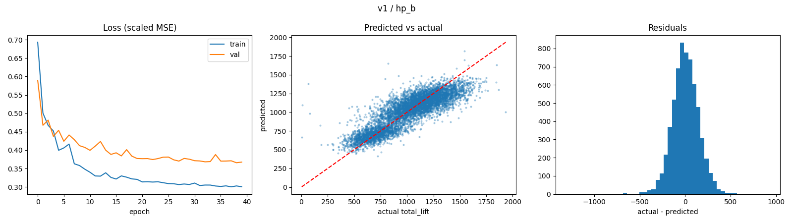
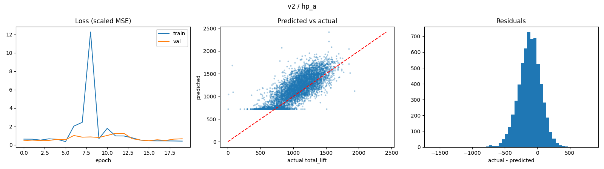
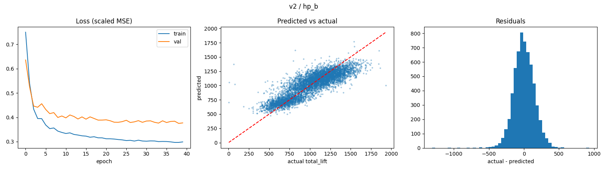

# dbx_hw2

# Predicting CrossFit Athlete Total Lift: MLOps Pipeline with a Databricks Feature Store

## 1. Data

`athletes.csv` was uploaded to a Unity Catalog volume (`/Volumes/workspace/athletes/athletes/`) and loaded into the Delta table `workspace.athletes.athletes_raw`. The prediction target is total lift: `deadlift + candj + snatch + backsq` (lb).

## 2. ML Pipeline

The pipeline runs on **Databricks** and uses MLflow for experiment tracking:

1. Load `athletes.csv` from the Unity Catalog volume into a Delta table
2. Clean the data and write two feature versions to the feature store
3. Build training sets from the feature store
4. Train and evaluate models, logging parameters, metrics, plots, and emissions to MLflow

## 3. Feature Store

Features are stored in the **Databricks Feature Store (Unity Catalog)** as feature tables with `athlete_id` as the primary key. All training and test data is pulled from the feature store with `create_training_set` and `FeatureLookup`, joining labels to features on `athlete_id`.

## 4. Feature Versions

| Version | Feature table | Rows | Features | Definition |
|---|---|---|---|---|
| v1 | `workspace.athletes.athlete_features_v1` | 30,832 | 68 | Keeps athletes who declined survey questions (declined answers become all-zero dummies) |
| v2 | `workspace.athletes.athlete_features_v2` | 30,015 | 67 | Drops athletes who declined any survey question |

Both versions include age, height, and weight; one-hot encoded region, gender, and training tenure (`howlong`); and multi-hot encoded survey responses for `eat`, `background`, `schedule`, and `experience`.

## 5. Experiments

The same algorithm, a feed-forward neural network (Keras MLP with ReLU hidden layers, SGD optimizer, MSE loss), was trained on both feature versions with two hyperparameter sets, for 4 runs total. No AutoML was used.

| Hyperparameter set | Learning rate | Epochs | Batch size | Hidden units | Dropout |
|---|---|---|---|---|---|
| hp_a | 0.05 | 20 | 250 | [64, 32] | 0.0 |
| hp_b | 0.01 | 40 | 128 | [128, 64] | 0.2 |

Each run was logged to MLflow with its feature version, hyperparameters, test metrics, emissions, and diagnostic plots.

## 6. Experiment Comparison

### Quantitative (model metrics)

Test set, target = total lift (lb):

| Run | RMSE | MAE | R² |
|---|---|---|---|
| v1_hp_b | **145.6** | **112.6** | **0.725** |
| v2_hp_b | 146.1 | 113.6 | 0.722 |
| v1_hp_a | 146.2 | 112.9 | 0.722 |
| v2_hp_a | 210.9 | 165.3 | 0.422 |

- **Hyperparameters:** hp_b performed best on both feature versions. On v1 the improvement over hp_a was small (RMSE 146.2 → 145.6). On v2 it was large (210.9 → 146.1).
- **Feature versions:** Under hp_b, v1 and v2 performed almost identically (RMSE 145.6 vs. 146.1).
- **Instability:** v2_hp_a is a clear outlier (R² 0.42). Since v2 matches v1 under hp_b, the drop comes from training instability with hp_a's higher learning rate, not from weaker features.

### Qualitative (model plots)

- **Loss curves:** Both hp_b runs converge smoothly, with validation loss leveling off around 0.37–0.38 (scaled MSE). Both hp_a runs show early loss spikes from the higher learning rate. v1_hp_a recovers by epoch 4 and then converges cleanly, while v2_hp_a's training loss spikes to about 12 at epoch 8 and its validation loss stays erratic.
- **Predicted vs. actual:** The three strong runs cluster around the diagonal but under-predict the strongest athletes and over-predict the weakest. v2_hp_a shows a hard prediction floor: athletes with actual totals of about 300–900 lb are all predicted at roughly 720 lb.
- **Residuals:** The three strong runs have residuals roughly centered at zero, mostly within ±300 lb. v2_hp_a's residuals are shifted negative (peak around −100 lb), meaning it systematically over-predicts.

Each figure shows (left to right): training/validation loss, predicted vs. actual total lift, and the residual distribution.

**v1_hp_a**

**v1_hp_b**

**v2_hp_a**

**v2_hp_b**

Full metrics for all runs: [results/experiment_comparison.csv](results/experiment_comparison.csv)

## 7. Carbon Emissions Comparison

Emissions were measured with CodeCarbon during model training and logged to MLflow for each run.

| Run | Train time (s) | Energy (Wh) | CO₂ (mg) |
|---|---|---|---|
| v1_hp_a | 4.6 | 0.0084 | 3.1 |
| v2_hp_a | 4.9 | 0.0098 | 3.6 |
| v2_hp_b | 18.7 | 0.0358 | 13.2 |
| v1_hp_b | 19.0 | 0.0379 | 14.0 |

- **hp_b emitted about 3.6–4.5× more CO₂ than hp_a.** It runs twice the epochs with about half the batch size, so roughly 4× the gradient updates, and emissions grew by about the same factor.
- **Accuracy vs. carbon:** On v1, hp_b's extra carbon bought only about a 0.4% reduction in RMSE. On v2, it made the difference between an unstable model and a good one.
- **Feature version had little effect on emissions,** since the two datasets are nearly the same size.
- **Note:** On Databricks serverless compute, CodeCarbon estimates energy from runtime and an assumed CPU power rather than hardware readings, so the relative comparison between runs is more reliable than the absolute values.